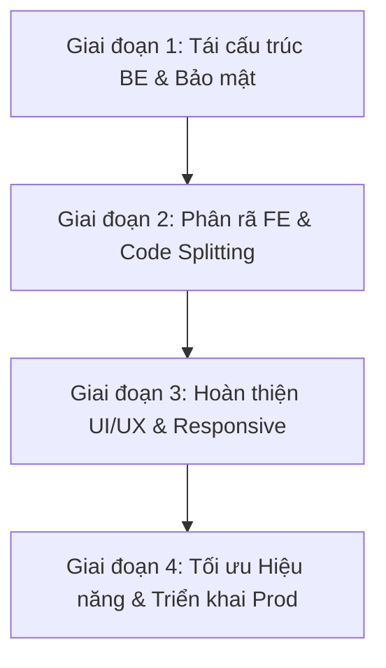

# KẾ HOẠCH CẢI TIẾN TOÀN DIỆN HỆ THỐNG KDPD (RUNBOOK & GUIDELINES)

Tài liệu này đóng vai trò là kim chỉ nam và quy trình chuẩn (Runbook) định hướng toàn bộ các giai đoạn tái cấu trúc, nâng cấp tính năng, tối ưu hiệu năng và gia cố an ninh thông tin cho hệ thống Quản lý Dự án Kinh điển phương Đông (KDPD_PRJ_MNG).

---

## I. MỤC TIÊU VÀ NGUYÊN TẮC CỐT LÕI

1. **Nguyên tắc Không gián đoạn (Zero Downtime / Zero Blast Radius):**
   - Mọi thay đổi về cấu trúc mã nguồn không được làm thay đổi API contract đang chạy của Frontend trừ khi có kế hoạch migration rõ ràng.
   - Cơ sở dữ liệu và dữ liệu lịch sử phải được bảo toàn 100%. Không xóa cột, không drop bảng, không ghi đè dữ liệu nghiệp vụ.
2. **Quy tắc 80/20 Design System:**
   - 80% giao diện tuân thủ Design System chung (bảng màu văn hóa truyền thống, typography, spacing, skeleton loading).
   - 20% tùy biến đặc thù theo tính chất nghiệp vụ từng bộ phận (Biên tập, Thiết kế, CNTT, Thư ký hợp phần).
3. **Module hóa triệt để (Separation of Concerns):**
   - Loại bỏ các file "siêu to khổng lồ" (> 100 KB hoặc > 2,000 dòng). Mỗi tệp mã nguồn chỉ nên đảm nhận một phạm vi trách nhiệm rõ ràng.

---

## II. LỘ TRÌNH TRIỂN KHAI 4 GIAI ĐOẠN



---

### GIAI ĐOẠN 1: TÁI CẤU TRÚC BACKEND & GIA CỐ BẢO MẬT (BE & SECURITY)

#### 1.1. Phân rã `server/routes.ts` (Hiện tại 5,123 dòng, 179 KB)
Tách thành các route module chuyên biệt đặt trong thư mục `server/routes/`:
- `server/routes/auth.routes.ts`:
  - Đăng nhập (Local Strategy Passport), đăng xuất, `me`.
  - Đổi mật khẩu, quên mật khẩu, verify mật khẩu.
  - Rate limiter bảo vệ endpoint xác thực.
- `server/routes/tasks.routes.ts`:
  - CRUD công việc (`/api/tasks`).
  - Phân công (`task_assignments`), đính kèm (`attachments`), bình luận (`comments`).
  - Cache memory quản lý theo TTL (`TASKS_LIST_CACHE_TTL_MS`).
- `server/routes/works.routes.ts`:
  - Quản lý tác phẩm (`works`), hợp phần (`components`).
  - Import file Excel danh mục tác phẩm (`/api/works/import`).
- `server/routes/contracts.routes.ts`:
  - Hợp đồng dịch thuật (`translation_contracts`), hợp đồng hiệu đính (`proofreading_contracts`).
  - Đợt duyệt (`stages`), thành viên hợp đồng (`contract_members`), quyết toán thù lao (`payments`).
- `server/routes/users.routes.ts`:
  - Quản lý người dùng, nhóm phòng ban, vai trò (Roles & Groups).
  - Tải lên ảnh đại diện (`/api/users/avatar`) với kiểm tra Magic Bytes.
- `server/routes/backup.routes.ts`:
  - Quản lý sao lưu dữ liệu (`pg_dump`), lịch trình tự động, tải file backup, restore dữ liệu.
- `server/routes/notifications.routes.ts`:
  - Quản lý thông báo người dùng, đánh dấu đã đọc/quan trọng, Web Push API.
- `server/routes/index.ts`:
  - Điểm tập trung đăng ký tất cả router con vào `Express App`.

#### 1.2. Khắc phục lỗ hổng tiềm ẩn tại Endpoint Dev
- Tệp liên quan: `server/routes.ts#L393-L414` (endpoint `/api/dev/fix-password-hashes`).
- **Hành động bắt buộc:** 
  1. Thêm `requireAuth` và kiểm tra quyền `UserRole.ADMIN`.
  2. Bổ sung kiểm tra địa chỉ IP cục bộ (`127.0.0.1` hoặc `localhost`), không cho phép kích hoạt từ mạng ngoài hoặc IP LAN kể cả khi `NODE_ENV === "development"`.

#### 1.3. Chuẩn bị phân trang cơ sở dữ liệu (Database-level Pagination)
- Hiện trạng: `/api/tasks` select toàn bộ bảng tasks từ DB.
- **Hành động:**
  - Hỗ trợ query params: `?page=1&limit=50&status=...`.
  - Tương thích ngược: Nếu client không truyền `limit`, tiếp tục trả về đầy đủ mảng để không làm gãy các view hiện hữu.
  - Viết helper `paginate()` tái sử dụng trong `server/db-storage.ts`.

#### 1.4. Bật CSP (Content Security Policy)
- Bật `CSP_ENABLED=true` trong môi trường sản xuất.
- Đảm bảo các nguồn ảnh ngoài (Dicebear, Gravatar, Google Calendar API) và Font chữ nằm trong danh sách allowlist an toàn.

---

### GIAI ĐOẠN 2: PHÂN RÃ FRONTEND & CHUẨN HÓA MÃ NGUỒN (FE REFACTOR)

#### 2.1. Phân rã trang Thư ký hợp phần (`client/src/pages/thu-ky-hop-phan.tsx` - 359 KB)
Tách file thành các sub-components đặt tại `client/src/pages/thu-ky-hop-phan/`:
1. `components/ThuKyHeaderSection.tsx`: Tiêu đề, thẻ thống kê tổng quan, nút xuất báo cáo.
2. `components/ThuKyTasksTab.tsx`: Bảng công việc phân theo hợp phần, bộ lọc kỳ, phân công.
3. `components/ThuKyWorksTab.tsx`: Danh mục tác phẩm nguồn, khối lượng chữ, số trang, hệ số quy đổi.
4. `components/ThuKyContractsTab.tsx`: Danh mục hợp đồng dịch thuật/hiệu đính, tiến độ nghiệm thu.
5. `components/ThuKyFinanceTab.tsx`: Bảng kê quyết toán thù lao, thanh toán tạm ứng.
6. Kết hợp 3 hooks độc lập: `useThuKyTasksTab`, `useThuKyWorksTab`, `useThuKyContractsTab`.

#### 2.2. Phân rã Modal Chi tiết Công việc (`client/src/components/task-dialog.tsx` - 198 KB)
Tách `TaskDialog` thành các Tab Component riêng biệt:
- `TaskGeneralTab.tsx`: Tiêu đề, mô tả, phòng ban, độ ưu tiên, thẻ tags, thời hạn hoàn thành.
- `TaskAssignmentTab.tsx`: Danh sách nhân sự thực hiện, ngày nhận việc, người kiểm soát, đợt duyệt.
- `TaskCanonicalTab.tsx`: Tác phẩm liên kết, số từ, số trang, loại đợt duyệt (Biên tập).
- `TaskAttachmentsTab.tsx`: Danh sách tài liệu đính kèm, ghi chú, lịch sử thay đổi.

#### 2.3. Khắc phục Side-effect Điều hướng trong `client/src/App.tsx`
- Sửa các hàm Guard:
  ```tsx
  // TRƯỚC (Rủi ro side-effect render):
  if (!allowed) { navigate("/"); return null; }

  // SAU (Chuẩn React & Wouter):
  if (!allowed) {
    return <Redirect to="/" replace />;
  }
  ```

---

### GIAI ĐOẠN 3: HOÀN THIỆN TRẢI NGHIỆM NGƯỜI DÙNG & GIAO DIỆN (UI/UX)

#### 3.1. Đồng bộ hóa Trạng thái Chờ (Skeleton Loaders)
- Thay thế hoàn toàn `<Loader2 className="animate-spin" />` bằng Skeleton component:
  - `TaskTableSkeleton`: Khung xương mô phỏng 5 dòng bảng với các cột badge, tiêu đề, tiến độ.
  - `CardGridSkeleton`: Khung xương dạng lưới thẻ cho trang Team và Dashboard.
  - `DetailDialogSkeleton`: Khung xương khi tải dữ liệu chi tiết công việc.

#### 3.2. Nâng cao Khả năng Tiếp cận (Accessibility - A11y)
- Đảm bảo tất cả các icon-button có `aria-label` tương ứng (việt ngữ / anh ngữ).
- Hỗ trợ đầy đủ phím tắt bàn phím:
  - `Esc`: Đóng dialog / sheet.
  - `Ctrl + K` / `Cmd + K`: Mở Command Palette tìm kiếm nhanh.
  - `Tab` / `Shift + Tab`: Di chuyển tuần tự trong form modal không bị kẹt focus.

#### 3.3. Tối ưu Giao diện Thiết bị Di động (Mobile UX)
- Với màn hình `< 768px`:
  - Tự động chuyển bảng `TaskTable` sang chế độ Thẻ thông tin rút gọn (Compact Task Cards) để tránh cuộn ngang phức tạp.
  - Mở rộng vùng chạm tối thiểu (Touch Target Size >= 44×44px) cho các nút thao tác nhanh và checkbox.

---

### GIAI ĐOẠN 4: TỐI ƯU HIỆU NĂNG & SẴN SÀNG TRIỂN KHAI (PERFORMANCE & DEPLOY)

#### 4.1. Tối ưu Bundle & Core Web Vitals (Mobile Performance)
- Cấu hình chia nhỏ vendor chunks chi tiết hơn trong `vite.config.ts`:
  - `vendor-react`: `react`, `react-dom`, `wouter`
  - `vendor-radix`: Toàn bộ các package `@radix-ui/*`
  - `vendor-dnd`: `@dnd-kit/*`
  - `vendor-charts`: `recharts` (chỉ load khi vào trang có biểu đồ)
  - `vendor-excel`: `xlsx` (chỉ load khi người dùng ấn nút Export Excel)
- Bổ sung `<link rel="preload">` cho font chữ hiển thị chính (`Outfit` / `Inter`) trong `client/index.html`.

#### 4.2. Cấu hình Nginx Máy chủ Sản xuất
Thiết lập nén Gzip / Brotli và cache tài nguyên tĩnh:
```nginx
# Bật nén Brotli & Gzip
gzip on;
gzip_types text/plain text/css application/json application/javascript text/xml application/xml image/svg+xml;
gzip_min_length 1000;

# Cache tài nguyên tĩnh đã băm tên (Hashed Assets)
location /assets/ {
    expires 1y;
    add_header Cache-Control "public, immutable";
}
```

#### 4.3. Bộ quy chuẩn Kiểm thử Tự động (Automated Verification Checklist)
Mỗi lần hoàn thành một bước cải tiến, bắt buộc chạy kiểm tra:
1. `npm run check` (TypeScript static analysis) — đảm bảo 0 errors.
2. Kiểm tra tính toàn vẹn chức năng: Đăng nhập -> Xem Dashboard -> Lọc kỳ -> Mở modal -> Tạo việc -> Xuất Excel.
3. Chạy `node script/load-test.js` kiểm tra độ trễ trung bình của API.

---

## III. BẢNG PHÂN CÔNG & THỨ TỰ THỰC HIỆN (CHECKLIST)

| STT | Nhiệm vụ | File tác động | Độ ưu tiên | Trạng thái |
|:---:|---|---|:---:|:---:|
| 1 | Sửa side-effect điều hướng trong Guarded Routes | [client/src/App.tsx](file:///d:/Vincent/DEV/KDPD_PRJ_MNG/client/src/App.tsx) | P0 (Ngay) | ✅ Hoàn thành |
| 2 | Gia cố bảo mật endpoint fix password dev | [server/routes.ts](file:///d:/Vincent/DEV/KDPD_PRJ_MNG/server/routes.ts) | P0 (Ngay) | ✅ Hoàn thành |
| 3 | Tách module `server/routes.ts` thành thư mục `server/routes/` | [server/routes.ts](file:///d:/Vincent/DEV/KDPD_PRJ_MNG/server/routes.ts) -> `server/routes/*.ts` | P1 (Cao) | ✅ Hoàn thành |
| 4 | Phân rã `thu-ky-hop-phan.tsx` thành các sub-components | [client/src/pages/thu-ky-hop-phan.tsx](file:///d:/Vincent/DEV/KDPD_PRJ_MNG/client/src/pages/thu-ky-hop-phan.tsx) | P1 (Cao) | ⏳ Chờ thực hiện |
| 5 | Phân rã `task-dialog.tsx` theo tab | [client/src/components/task-dialog.tsx](file:///d:/Vincent/DEV/KDPD_PRJ_MNG/client/src/components/task-dialog.tsx) | P2 (Trung bình) | ⏳ Chờ thực hiện |
| 6 | Thêm Skeleton loading đồng bộ toàn bộ trang | `client/src/components/ui/skeletons.tsx` | P2 (Trung bình) | ⏳ Chờ thực hiện |
| 7 | Tối ưu hóa vendor chunks trong `vite.config.ts` | [vite.config.ts](file:///d:/Vincent/DEV/KDPD_PRJ_MNG/vite.config.ts) | P2 (Trung bình) | ⏳ Chờ thực hiện |
| 8 | Thiết lập cấu hình Nginx & deploy hướng dẫn | [Docs/DEPLOY.md](file:///d:/Vincent/DEV/KDPD_PRJ_MNG/Docs/DEPLOY.md) | P3 (Thấp) | ⏳ Chờ thực hiện |
