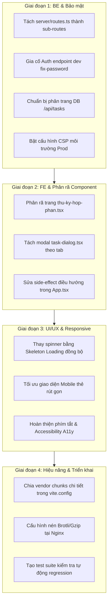

# 📋 KẾ HOẠCH CẢI TIẾN TOÀN DIỆN HỆ THỐNG KDPD (PROJECT MANAGEMENT SYSTEM)

> **Tài liệu tham chiếu:** Kế hoạch hành động cải tiến Backend, Frontend, UI/UX, Hiệu năng và Bảo mật  
> **Dự án:** Quản lý Dự án & Tiến độ Kinh điển phương Đông (`KDPD_PRJ_MNG`)  
> **Phiên bản:** 1.0 — Ngày lập: 15/10/2026  
> **File Skill nội bộ:** [.agents/skills/kdpd-refactor-improvement-plan/SKILL.md](file:///d:/Vincent/DEV/KDPD_PRJ_MNG/.agents/skills/kdpd-refactor-improvement-plan/SKILL.md)  

---

## I. MỤC TIÊU VÀ NGUYÊN TẮC BẢO TOÀN

1. **Zero Blast Radius:** Giữ nguyên 100% hợp đồng API và logic nghiệp vụ đang hoạt động. Không sửa đổi schema hay làm xáo trộn dữ liệu thực tế trên PostgreSQL Neon.
2. **Module hóa sạch sẽ (Clean Architecture):** Xóa bỏ các tập tin có dung lượng quá tải (> 100 KB hoặc > 2,000 dòng mã) để giảm thiểu nợ kỹ thuật (Technical Debt).
3. **Thống nhất Design System 80/20:** 80% thành phần giao diện chia sẻ chung ngôn ngữ thiết kế (màu sắc văn hóa, phông chữ, khoảng cách, bộ lọc, Skeleton loading), 20% còn lại là tính năng đặc thù của từng phân hệ nghiệp vụ.
4. **Hiệu năng & An toàn chuẩn Doanh nghiệp:** Đưa điểm Lighthouse Mobile từ 55 lên > 80, giữ vững Desktop 91+, kích hoạt đầy đủ các chốt chặn bảo mật (CSP, Route Guarding, Rate Limiting).

---

## II. LỘ TRÌNH 4 GIAI ĐOẠN CHI TIẾT



---

### GIAI ĐOẠN 1: TÁI CẤU TRÚC BACKEND & CỦNG CỐ BẢO MẬT (Ưu tiên P0 - P1)

#### 1.1. Tách tệp `server/routes.ts` (Hiện tại 5,123 dòng, 179 KB)
Tách thành các route module chuyên biệt đặt trong thư mục `server/routes/`:
- `server/routes/auth.routes.ts`:
  - Đăng nhập (Local Strategy Passport), đăng xuất, `me`.
  - Đổi mật khẩu, quên mật khẩu, verify mật khẩu.
  - Rate limiter bảo vệ endpoint xác thực.
- `server/routes/tasks.routes.ts`:
  - CRUD công việc (`/api/tasks`).
  - Phân công (`task_assignments`), đính kèm (`attachments`), bình luận (`comments`).
  - Cache memory quản lý theo TTL (`TASKS_LIST_CACHE_TTL_MS`).
- `server/routes/works.routes.ts`:
  - Quản lý tác phẩm (`works`), hợp phần (`components`).
  - Import file Excel danh mục tác phẩm (`/api/works/import`).
- `server/routes/contracts.routes.ts`:
  - Hợp đồng dịch thuật (`translation_contracts`), hợp đồng hiệu đính (`proofreading_contracts`).
  - Đợt duyệt (`stages`), thành viên hợp đồng (`contract_members`), quyết toán thù lao (`payments`).
- `server/routes/users.routes.ts`:
  - Quản lý người dùng, nhóm phòng ban, vai trò (Roles & Groups).
  - Tải lên ảnh đại diện (`/api/users/avatar`) với kiểm tra Magic Bytes.
- `server/routes/backup.routes.ts`:
  - Quản lý sao lưu dữ liệu (`pg_dump`), lịch trình tự động, tải file backup, restore dữ liệu.
- `server/routes/notifications.routes.ts`:
  - Quản lý thông báo người dùng, đánh dấu đã đọc/quan trọng, Web Push API.
- `server/routes/index.ts`:
  - Điểm tập trung đăng ký tất cả router con vào `Express App`.

#### 1.2. Khắc phục lỗ hổng endpoint Dev `fix-password-hashes`
- Vị trí: [server/routes.ts#L393-L414](file:///d:/Vincent/DEV/KDPD_PRJ_MNG/server/routes.ts#L393-L414).
- **Hành động:** Bắt buộc áp dụng `requireAuth`, kiểm tra vai trò `UserRole.ADMIN`, và chỉ cho phép gọi từ localhost/127.0.0.1.

#### 1.3. Chuẩn bị phân trang cấp DB cho `/api/tasks`
- Thêm hỗ trợ tham số `page`, `limit` vào tầng storage ([server/db-storage.ts](file:///d:/Vincent/DEV/KDPD_PRJ_MNG/server/db-storage.ts)).
- Đảm bảo tương thích ngược: nếu không truyền `limit`, hệ thống vẫn trả về toàn bộ mảng dữ liệu để không làm ảnh hưởng giao diện hiện tại.

---

### GIAI ĐOẠN 2: PHÂN RÃ FRONTEND & CHUẨN HÓA MÃ NGUỒN (Ưu tiên P1)

#### 2.1. Phân rã trang Thư ký hợp phần (`client/src/pages/thu-ky-hop-phan.tsx` - 359 KB)
Tách thành các component tab độc lập trong `client/src/pages/thu-ky-hop-phan/`:
1. `ThuKyTasksTab.tsx`: Bảng công việc theo hợp phần, bộ lọc kỳ báo cáo, phân công.
2. `ThuKyWorksTab.tsx`: Quản lý danh mục tác phẩm, khối lượng trang, chữ, hệ số quy đổi.
3. `ThuKyContractsTab.tsx`: Danh mục hợp đồng dịch thuật/hiệu đính, tiến độ nghiệm thu.
4. `ThuKyFinanceTab.tsx`: Bảng kê quyết toán thù lao, thanh toán tạm ứng.
5. Sử dụng 3 custom hook đã định hình: `useThuKyTasksTab`, `useThuKyWorksTab`, `useThuKyContractsTab`.

#### 2.2. Phân rã Modal Chi tiết Công việc (`client/src/components/task-dialog.tsx` - 198 KB)
Tách modal thành 4 tab con:
- `TaskGeneralTab.tsx`: Thông tin cốt lõi (Tiêu đề, mô tả, phòng ban, độ ưu tiên, hạn nộp).
- `TaskAssignmentTab.tsx`: Phân công nhân sự, ngày nhận, người kiểm soát, đợt duyệt.
- `TaskCanonicalTab.tsx`: Tác phẩm nguồn, khối lượng từ/trang, loại đợt duyệt.
- `TaskAttachmentsTab.tsx`: Tài liệu đính kèm, ghi chú, lịch sử thay đổi.

#### 2.3. Sửa Side-effect Điều hướng trong `client/src/App.tsx`
- Sửa hàm kiểm tra quyền truy cập:
  ```tsx
  // Thay thế lệnh gọi trực tiếp navigate("/") trong thân render:
  if (!allowed) {
    return <Redirect to="/" replace />;
  }
  ```

---

### GIAI ĐOẠN 3: TỐI ƯU GIAO DIỆN & TRẢI NGHIỆM NGƯỜI DÙNG (UI/UX) (Ưu tiên P2)

#### 3.1. Đồng bộ hóa Trạng thái Chờ (Skeleton Loaders)
- Thay thế hoàn toàn các spinner `<Loader2 className="animate-spin" />` bằng:
  - `TaskTableSkeleton`: Mô phỏng 5 dòng bảng với tiêu đề, badge và avatar.
  - `CardGridSkeleton`: Mô phỏng dạng lưới thẻ (Team / Dashboard).
  - `FormSkeleton`: Khung xương khi tải form tác vụ.

#### 3.2. Nâng cấp Trải nghiệm Di động (Mobile UX)
- Với màn hình hẹp `< 768px`: Chuyển đổi bảng dữ liệu rộng sang chế độ thẻ rút gọn (Compact Task Card), tránh thanh cuộn ngang phức tạp.
- Đảm bảo vùng bấm (Touch Target Size) cho nút bấm và checkbox tối thiểu $44 \times 44\text{px}$.

---

### GIAI ĐOẠN 4: TỐI ƯU HIỆU NĂNG & TRIỂN KHAI SẢN XUẤT (Ưu tiên P2 - P3)

#### 4.1. Tối ưu Bundle & Core Web Vitals
- Tinh chỉnh `vite.config.ts` để phân nhỏ vendor:
  - `vendor-radix`: Toàn bộ các package UI Radix.
  - `vendor-dnd`: Thư viện kéo thả Kanban `@dnd-kit`.
  - `vendor-charts`: `recharts` (chỉ load khi vào Dashboard/Team).
  - `vendor-excel`: `xlsx` (chỉ load khi bấm Export).
- Preload font chữ chính trong `client/index.html`.

#### 4.2. Cấu hình Nginx Máy chủ Sản xuất
- Bật nén Brotli và Gzip tự động.
- Cấu hình header `Cache-Control: public, immutable` cho các file tĩnh trong `/assets/`.

---

## III. BẢNG CHECKLIST THEO DÕI TIẾN ĐỘ THỰC HIỆN

| STT | Hạng mục công việc | File liên quan | Mức độ ưu tiên | Trạng thái |
|:---:|---|---|:---:|:---:|
| 1 | Sửa side-effect điều hướng trong Guarded Routes | [client/src/App.tsx](file:///d:/Vincent/DEV/KDPD_PRJ_MNG/client/src/App.tsx) | **P0** (Khẩn cấp) | ✅ Hoàn thành |
| 2 | Gia cố bảo mật endpoint fix password dev | [server/routes.ts](file:///d:/Vincent/DEV/KDPD_PRJ_MNG/server/routes.ts) | **P0** (Khẩn cấp) | ✅ Hoàn thành |
| 3 | Tách module `server/routes.ts` thành thư mục `server/routes/` | [server/routes.ts](file:///d:/Vincent/DEV/KDPD_PRJ_MNG/server/routes.ts) | **P1** (Cao) | ✅ Hoàn thành |
| 4 | Phân rã trang `thu-ky-hop-phan.tsx` thành các sub-components | [client/src/pages/thu-ky-hop-phan.tsx](file:///d:/Vincent/DEV/KDPD_PRJ_MNG/client/src/pages/thu-ky-hop-phan.tsx) | **P1** (Cao) | ✅ Hoàn thành |
| 5 | Phân rã modal `task-dialog.tsx` theo tab | [client/src/components/task-dialog.tsx](file:///d:/Vincent/DEV/KDPD_PRJ_MNG/client/src/components/task-dialog.tsx) | **P2** (Trung bình) | ✅ Hoàn thành |
| 6 | Thêm Skeleton loading đồng bộ & tối ưu Mobile UX | `client/src/components/ui/skeletons.tsx` | **P2** (Trung bình) | ✅ Hoàn thành |
| 7 | Tối ưu hóa vendor chunks trong `vite.config.ts` | [vite.config.ts](file:///d:/Vincent/DEV/KDPD_PRJ_MNG/vite.config.ts) | **P2** (Trung bình) | ✅ Hoàn thành |
| 8 | Cập nhật tài liệu triển khai Nginx & Production | [Docs/DEPLOY.md](file:///d:/Vincent/DEV/KDPD_PRJ_MNG/Docs/DEPLOY.md) | **P3** (Tiêu chuẩn) | ✅ Hoàn thành |
