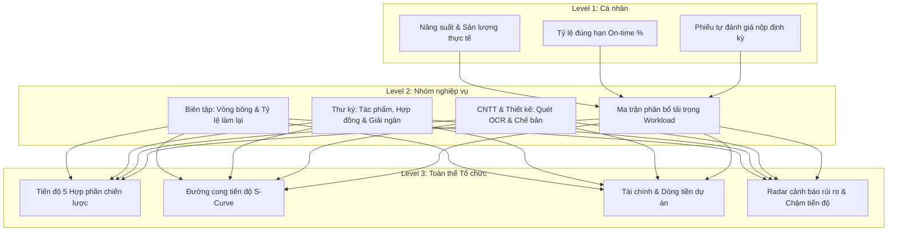
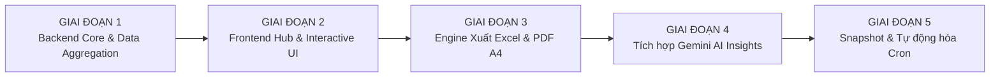

# 📊 KẾ HOẠCH CHI TIẾT & BẢN ĐẶC TẢ KỸ THUẬT: TÍNH NĂNG BÁO CÁO CÔNG VIỆC TỰ ĐỘNG (AUTOMATED WORK REPORTING SYSTEM)

> **Dự án:** Quản lý Dự án & Tiến độ Kinh điển Phương Đông (`KDPD_PRJ_MNG`)  
> **Cơ quan chủ quản:** Dự án Kinh điển Phương Đông  
> **Phiên bản:** 1.0 — Ngày lập: 15/10/2026  
> **Trạng thái:** Bản thiết kế kiến trúc và Kế hoạch thực hiện từng bước (Master Architectural Specification & Step-by-Step Action Plan)  
> **Tài liệu liên quan:** [Docs/KE_HOACH_CAI_TIEN_TOAN_DIEN.md](file:///e:/Vincent/DEV/KDPD_PRJ_MNG/Docs/KE_HOACH_CAI_TIEN_TOAN_DIEN.md) | [Docs/UI_UX_REDESIGN_PLAN.md](file:///e:/Vincent/DEV/KDPD_PRJ_MNG/Docs/UI_UX_REDESIGN_PLAN.md)

---

## MỤC LỤC
1. [Bối cảnh nghiệp vụ & Mục tiêu chiến lược](#i-bối-cảnh-nghiệp-vụ--mục-tiêu-chiến-lược)
2. [Nguyên tắc thiết kế & Giới hạn an toàn (Non-Negotiable Principles)](#ii-nguyên-tắc-thiết-kế--giới-hạn-an-toàn)
3. [Mô hình Báo cáo 3 Cấp độ (3-Tier Reporting Hierarchy)](#iii-mô-hình-báo-cáo-3-cấp-độ)
   - [3.1. Cấp Cá nhân (Personal Productivity Report)](#31-cấp-cá-nhân-personal-productivity-report)
   - [3.2. Cấp Nhóm nghiệp vụ (Departmental & Operational Workflow Report)](#32-cấp-nhóm-nghiệp-vụ-departmental-report)
   - [3.3. Cấp Toàn thể Tổ chức (Executive Governance Report)](#33-cấp-toàn-thể-tổ-chức-executive-governance-report)
4. [Kiến trúc Kỹ thuật & Luồng xử lý Dữ liệu (Technical Architecture)](#iv-kiến-trúc-kỹ-thuật--luồng-xử-lý-dữ-liệu)
   - [4.1. Sơ đồ luồng tổng thể](#41-sơ-đồ-luồng-tổng-thể)
   - [4.2. Bộ máy Tổng hợp Chỉ số (Backend Aggregation Engine)](#42-bộ-máy-tổng-hợp-chỉ-số-backend-aggregation-engine)
   - [4.3. Mô hình Dữ liệu Bổ sung (Schema Enhancements)](#43-mô-hình-dữ-liệu-bổ-sung-schema-enhancements)
5. [Cơ chế Tự động hóa & Trí tuệ Nhân tạo (Automation & AI Insights Engine)](#v-cơ-chế-tự-động-hóa--trí-tuệ-nhân-tạo)
6. [Đa kênh Xuất bản & Chuẩn hóa Định dạng (Multi-Format Export Engine)](#vi-đa-kênh-xuất-bản--chuẩn-hóa-định-dạng)
7. [Thiết kế Giao diện Người dùng (UI/UX Specification)](#vii-thiết-kế-giao-diện-người-dùng-uiux-specification)
8. [Lộ trình Triển khai Chắc chắn 5 Giai đoạn (Phased Implementation Roadmap)](#viii-lộ-trình-triển-khai-chắc-chắn-5-giai-đoạn)
9. [Bộ Tiêu chí Đánh giá & Nghiệm thu (Acceptance Criteria)](#ix-bộ-tiêu-chí-đánh-giá--nghiệm-thu)

---

## I. BỐI CẢNH NGHIỆP VỤ & MỤC TIÊU CHIẾN LƯỢC

### 1.1. Hiện trạng và Điểm nghẽn
Dự án Kinh điển Phương Đông (KDPD) là một công trình dịch thuật, học thuật và số hóa đồ sộ với hàng ngàn đầu tác phẩm trải dài qua nhiều hợp phần (*Phật tạng toàn dịch, Phật tạng tinh yếu, Phật điển, Nho tạng, Nho điển*). Quá trình vận hành đòi hỏi sự tham gia đồng thời của nhiều đối tượng:
- Ban Chủ nhiệm / Ban Giám đốc quản lý tiến độ tổng thể và ngân sách.
- Thư ký hợp phần theo dõi hợp đồng, nghiệm thu, thanh toán tạm ứng/quyết toán.
- Ban Biên tập kiểm soát quy trình đa vòng (Bông 1 $\to$ Bông 2 $\to$ Đọc duyệt).
- Đội ngũ CNTT & Thiết kế phụ trách quét trùng lặp, OCR, số hóa và chế bản in ấn.
- Đội ngũ Chuyên viên xử lý công việc chung và hậu cần.

**Thách thức lớn nhất hiện nay:**
1. **Dữ liệu phân mảnh:** Từng trang nhóm nghiệp vụ đang quản lý danh sách việc độc lập; việc tổng hợp báo cáo tuần/tháng/quý phải thực hiện thủ công bằng cách xuất Excel thô rồi cắt dán, dễ sai sót và tốn thời gian.
2. **Thiếu chuẩn hóa báo cáo theo 3 cấp:** Người dùng cá nhân khó tự đánh giá hiệu suất của chính mình; Trưởng nhóm khó nhìn thấy sự cân đối tải trọng (ai quá tải, ai rảnh rỗi); Lãnh đạo viện không có một bức tranh tổng quan tức thời (Executive Bird's Eye View).
3. **Chưa có lưu trữ lịch sử báo cáo (Snapshot):** Khi một tác phẩm được cập nhật sau này, số liệu báo cáo của tháng trước bị biến động, gây khó khăn cho công tác kiểm toán và nghiệm thu định kỳ.
4. **Thiếu định dạng in ấn chuẩn hành chính:** Chưa có mẫu in PDF/A4 chuẩn văn bản viện nghiên cứu để trình ký trực tiếp.

### 1.2. Mục tiêu chiến lược của Hệ thống Báo cáo Tự động
- **Tự động hóa 100% việc tính toán số liệu:** Chỉ với 1 cú nhấp chuột (hoặc theo lịch định kỳ), hệ thống kết xuất toàn bộ chỉ số KPI, sản lượng trang/chữ, tiến độ và tài chính.
- **Phục vụ trọn vẹn 3 cấp độ:** Cá nhân $\to$ Nhóm nghiệp vụ $\to$ Toàn thể Tổ chức.
- **Tích hợp Trí tuệ Nhân tạo (Gemini AI):** Tự động phân tích số liệu, chỉ ra các điểm nghẽn, cảnh báo trễ hạn và đề xuất giải pháp xử lý dưới dạng văn phong báo cáo hành chính chuẩn mực.
- **Xuất bản đa định dạng chất lượng cao:** Web Dashboard tương tác cao $\to$ File Excel đa sheet chuẩn kế toán $\to$ Bản in PDF A4 trang trọng, sẵn sàng trình ký.

---

## II. NGUYÊN TẮC THIẾT KẾ & GIỚI HẠN AN TOÀN

Tuân thủ nghiêm ngặt **Quy chuẩn Runbook KDPD**:
1. **Zero Blast Radius (Bảo toàn dữ liệu tuyệt đối):**
   - Không can thiệp hoặc thay đổi các API contract hiện hành của `tasks`, `contracts`, `works`.
   - Toàn bộ bảng dữ liệu mới chỉ mang tính chất ghi vết hoặc mở rộng không phá vỡ (`ADD COLUMN IF NOT EXISTS` hoặc bảng lưu snapshot độc lập).
2. **Database-Level Aggregation (Tối ưu tải dữ liệu):**
   - Tuyệt đối không tải toàn bộ danh sách hàng ngàn tasks về trình duyệt hoặc RAM của Node.js để tính toán. Mọi phép đếm, tính tổng trang/chữ, tỷ lệ phần trăm phải được thực hiện thông qua câu truy vấn SQL tối ưu trên PostgreSQL Neon.
3. **Tuân thủ Chuẩn Kế toán & Hành chính Việt Nam:**
   - Số tiền và số lượng: Phân tách hàng nghìn bằng dấu chấm (`.`), phần thập phân bằng dấu phẩy (`,`) theo chuẩn kế toán Việt Nam đã xây dựng tại `formatNumberAccounting` và `formatPercent`.
   - Ngày tháng: Định dạng chuẩn `DD/MM/YYYY`.
4. **Phân quyền dữ liệu chặt chẽ (Role-Based Access Control):**
   - **Nhân viên thông thường:** Chỉ xem được Báo cáo Cá nhân của chính mình.
   - **Trưởng nhóm / Trưởng bộ phận:** Xem được Báo cáo Cá nhân và Báo cáo Nhóm mình phụ trách.
   - **Thư ký hợp phần:** Xem được Báo cáo Nhóm Thư ký và Hợp phần mình được gán phụ trách (`userRoles.componentId`).
   - **Admin / Ban Giám đốc (Manager):** Toàn quyền truy cập tất cả các cấp báo cáo từ Cá nhân, các Nhóm đến Toàn thể Tổ chức.

---

## III. MÔ HÌNH BÁO CÁO 3 CẤP ĐỘ



---

### 3.1. Cấp Cá nhân (Personal Productivity Report)
Dành cho từng nhân sự (Biên tập viên, Kỹ thuật viên, Thư ký, Chuyên viên).

* **Khối chỉ số tổng quan (KPI Summary Cards):**
  - **Tổng việc được giao trong kỳ:** Số lượng đầu việc được phân công (dựa theo `task_assignments`).
  - **Số việc đã hoàn thành:** Bao gồm số việc đúng hạn và số việc trễ hạn.
  - **Tỷ lệ đúng hạn (On-Time Completion Rate):** Đo lường tính chuẩn xác về mặt thời gian.
  - **Số việc đang thực hiện & Nguy cơ:** Phân loại theo *Đang đúng tiến độ*, *Sắp đến hạn (trong vòng 3 ngày)*, và *Đã quá hạn*.
* **Khối Sản lượng Chuyên môn (Role-Specific Work Output):**
  - *Đối với Biên tập viên:* Tổng số trang bản thảo Bông 1, Bông 2, Đọc duyệt đã hoàn thành; Danh mục các tác phẩm đã thẩm định.
  - *Đối với Kỹ thuật viên CNTT / Thiết kế:* Số trang tài liệu số hóa, số đầu việc quét trùng lặp, số tác phẩm hoàn tất ma-két bìa / layout.
  - *Đối với Thư ký hợp phần:* Số đợt duyệt nghiệm thu đã xử lý, số hợp đồng đã theo dõi và hồ sơ thanh toán hoàn tất.
* **Bảng kê công việc chi tiết (Detailed Task Sheet):**
  - Liệt kê chi tiết từng tác vụ: Mã việc, Tên tác phẩm liên quan, Hợp phần, Ngày nhận việc, Hạn chót, Ngày hoàn tất thực tế, Số ngày sớm/trễ, Điểm đánh giá (nếu có).
* **Đầu ra (Deliverables):**
  - Cho phép xuất file PDF/A4 **"Bản Báo cáo Tiến độ Công việc Cá nhân"** có chữ ký người lập để nộp cho Trưởng nhóm vào cuối tuần/cuối tháng.

---

### 3.2. Cấp Nhóm nghiệp vụ (Departmental Report)
Dành cho Trưởng ban Biên tập, Thư ký trưởng, Trưởng nhóm CNTT, Thiết kế, Công việc chung.

#### A. Trọng tâm Báo cáo theo từng Nhóm Chuyên trách
1. **Ban Biên tập (`bien_tap`):**
   - **Luân chuyển các vòng bông:** Tỷ lệ công việc ở Bông 1, Bông 2, Đọc duyệt và Bông in.
   - **Tỷ lệ làm lại (Redo / Revision Rate):** Đo lường chất lượng bản dịch nguồn; số lần phải hiệu chỉnh lại giữa các vòng bông.
   - **Tiến độ theo từng Biên tập viên:** So sánh sản lượng trang biên tập giữa các nhân sự trong ban.
2. **Nhóm Thư ký Hợp phần (`thu_ky_hop_phan`):**
   - **Tiến độ Tác phẩm:** Tỷ lệ tác phẩm đã dịch xong, đang hiệu đính, đang duyệt mẫu, sẵn sàng in ấn.
   - **Tiến độ Hợp đồng:** Tổng hợp hợp đồng dịch thuật và hiệu đính (Số hợp đồng đang chạy, đã nghiệm thu, bị kéo dài hoặc quá hạn).
   - **Báo cáo Tài chính Hợp phần:** Tổng giá trị hợp đồng ký kết, số tiền tạm ứng đã chi, số tiền thanh quyết toán thực tế, và dư nợ còn lại cần chuẩn bị dòng tiền.
3. **Nhóm CNTT & Thiết kế (`cntt`, `thiet_ke`):**
   - Khối lượng trang sách đã OCR, dữ liệu đối chiếu trùng lặp hoàn tất.
   - Khối lượng thiết kế bìa, chế bản ruột sách, file in nộp nhà xuất bản.
   - Tỷ lệ phối hợp giữa Kỹ thuật viên chính và các Trợ lý kỹ thuật.
4. **Nhóm Công việc chung (`cv_chung`):**
   - Khối lượng đầu việc hành chính, tổ chức hội nghị khoa học, quản trị văn phòng.
   - Tiến độ giải quyết các công việc phát sinh ngoài kế hoạch.

#### B. Ma trận Cân đối Tải trọng Nhóm (Workload Balancing Matrix)
- Biểu đồ nhiệt (Heatmap) hoặc biểu đồ thanh so sánh số việc đang mở của từng thành viên trong nhóm.
- Cảnh báo thành viên đang bị quá tải (> ngưỡng an toàn) hoặc thành viên đang có công suất nhàn rỗi để Trưởng nhóm điều phối lại nhiệm vụ.

---

### 3.3. Cấp Toàn thể Tổ chức (Executive Governance Report)
Dành cho Ban Chủ nhiệm Dự án KDPD, Ban Giám đốc Viện, Hội đồng Nghiệm thu.

* **Bảng Tình trạng 5 Hợp phần Chiến lược (5 Strategic Components Dashboard):**
  - Đo lường tiến độ của từng hợp phần: *Phật tạng toàn dịch, Phật tạng tinh yếu, Phật điển, Nho tạng, Nho điển*.
  - Tỷ lệ hoàn thành theo kế hoạch năm và toàn bộ dự án.
* **Đường cong Tiến độ Tích lũy (Cumulative S-Curve):**
  - Trực quan hóa đường cong tiến độ lũy kế (Baseline Plan vs. Actual Progress) theo tháng/quý.
  - Dự báo thời điểm hoàn tất các mốc bàn giao lớn.
* **Bức tranh Tài chính Toàn diện Dự án (Financial Burn Rate & Budget Execution):**
  - Tổng hạn mức ngân sách được duyệt.
  - Tổng giá trị hợp đồng đã giao kết.
  - Tổng số tiền thực chi (Tạm ứng + Quyết toán).
  - Tỷ lệ giải ngân so với tiến độ nghiệm thu thực tế.
* **Radar Cảnh báo Rủi ro & Nút thắt Chiến lược (Critical Escalation):**
  - Danh mục 10 tác phẩm/hợp phần có nguy cơ trễ hạn cao nhất hoặc đang bị đình trệ quá 30 ngày.
  - Phân tích nguyên nhân gốc rễ (chậm nộp bản dịch nguồn, vướng mắc bản quyền, chờ duyệt học thuật...).

---

## IV. KIẾN TRÚC KỸ THUẬT & LUỒNG XỬ LÝ DỮ LIỆU

### 4.1. Sơ đồ Luồng Tổng thể

```
[Người dùng tương tác] 
         │ (chọn cấp độ, kỳ báo cáo, bộ lọc)
         ▼
[Frontend: Reports Hub Page]
         │ (gọi API /api/reports/...)
         ▼
[Express Server: server/routes/reports.routes.ts]
         │ (xác thực & kiểm tra quyền RBAC)
         ▼
[Service: server/services/report-generator.ts]
         │
         ├───► [Database Neon/PostgreSQL: Truy vấn SQL Aggregate tối ưu]
         │        ├── tasks & task_assignments
         │        ├── works & components
         │        └── contracts & payments
         │
         ├───► [AI Engine: server/services/report-ai-insights.ts]
         │        └── Gửi số liệu tổng hợp -> Gemini API -> Nhận bản nhận định văn bản
         │
         ▼
[Trả về Dữ liệu Báo cáo Chuẩn hóa (ReportPayload)]
         │
         ├───► Hiển thị trực quan: Recharts + KPI Cards + Data Table
         ├───► Xuất file Excel: XLSX Multi-sheet Generator
         └───► Xuất bản in: HTML/CSS Print-ready Template (A4 Layout)
```

---

### 4.2. Bộ máy Tổng hợp Chỉ số (Backend Aggregation Engine)
Tách biệt hoàn toàn vào thư mục `server/services/report-generator.ts` nhằm đảm bảo nguyên tắc Clean Architecture.

Các hàm nghiệp vụ cốt lõi:
1. `generatePersonalReport(userId: string, period: ReportPeriod)`:
   - Truy vấn kết hợp `task_assignments` và `tasks`.
   - Tính toán `totalAssigned`, `completedCount`, `onTimeCount`, `overdueCount`, `totalEstimatedPages`.
2. `generateDepartmentReport(groupCode: string, period: ReportPeriod)`:
   - Gom nhóm theo từng phòng ban/nhóm nghiệp vụ.
   - Tính toán chỉ số phân bổ tải trọng giữa các thành viên.
   - Bổ sung chỉ số chuyên biệt (Vòng bông đối với Biên tập; Hợp đồng đối với Thư ký).
3. `generateOrganizationReport(period: ReportPeriod)`:
   - Tổng hợp trên toàn bộ bảng `works`, `components`, `contracts`, `payments`.
   - Tính toán tiến độ từng hợp phần và tình hình giải ngân ngân sách.

---

### 4.3. Mô hình Dữ liệu Bổ sung (Schema Enhancements)
Tạo bảng mới `report_snapshots` trong [shared/schema.ts](file:///e:/Vincent/DEV/KDPD_PRJ_MNG/shared/schema.ts) để lưu lại báo cáo đã chốt sổ, đảm bảo tính bất biến của dữ liệu lịch sử:

```typescript
// Bảng lưu Snapshot Báo cáo đã phê duyệt chốt sổ
export const reportSnapshots = pgTable("report_snapshots", {
  id: uuid("id").primaryKey().defaultRandom(),
  scope: text("scope").notNull(), // 'personal' | 'department' | 'organization'
  targetId: text("target_id"), // userId (nếu cá nhân), groupCode (nếu nhóm), 'all' (tổ chức)
  periodType: text("period_type").notNull(), // 'week' | 'month' | 'quarter' | 'year'
  periodValue: text("period_value").notNull(), // '2026-10', '2026-Q4', '2026'
  summaryData: jsonb("summary_data").notNull(), // Lưu toàn bộ KPI và số liệu tổng hợp
  aiInsights: text("ai_insights"), // Bản nhận định phân tích của AI
  generatedBy: uuid("generated_by").references(() => users.id, { onDelete: "set null" }),
  isLocked: boolean("is_locked").notNull().default(false), // Khóa không cho chỉnh sửa
  createdAt: timestamp("created_at", { withTimezone: true }).notNull().defaultNow(),
});
```

---

## V. CƠ CHẾ TỰ ĐỘNG HÓA & TRÍ TUỆ NHÂN TẠO

### 5.1. Trợ lý AI Phân tích Tự động (Gemini Insights Engine)
Sử dụng gói SDK Gemini API có sẵn trong hệ thống (`@google/genai`) để tạo ra bản nhận định tự động:
- **Đầu vào của AI:** JSON tóm tắt các con số thực tế (không gửi dữ liệu nhạy cảm hay thông tin cá nhân bảo mật):
  - Số lượng việc hoàn thành / trễ hạn.
  - Tỷ lệ đúng hạn so với kỳ trước.
  - Danh sách các tác phẩm có tiến độ chậm nhất.
- **Nhiệm vụ của AI (Prompt định hướng):**
  - Đóng vai trò là *Thư ký Chuyên môn Cấp cao của Viện Nghiên cứu*.
  - Viết văn bản báo cáo hành chính khoa học mạch lạc, gồm 3 phần:
    1. **Điểm sáng nổi bật (Key Achievements):** Những mốc đã vượt chỉ tiêu trong kỳ.
    2. **Tồn tại & Nút thắt (Bottlenecks & Critical Issues):** Điểm nghẽn về nhân sự hoặc quy trình.
    3. **Kiến nghị & Giải pháp (Actionable Recommendations):** Đề xuất cụ thể cho lãnh đạo để tháo gỡ.

### 5.2. Lịch trình Tự động Kết xuất Báo cáo (Cron Automation)
- Hệ thống hỗ trợ cấu hình job tự động (sử dụng tiến trình nền Node.js có sẵn):
  - **Cuối mỗi tuần (17:00 Thứ Sáu):** Tự động tạo bản nháp Báo cáo Tuần gửi thông báo Web Push / Notification cho từng nhân sự.
  - **Cuối mỗi tháng (Ngày làm việc cuối cùng của tháng):** Kết xuất Báo cáo Tháng của các Nhóm để Trưởng nhóm rà soát.

---

## VI. ĐA KÊNH XUẤT BẢN & CHUẨN HÓA ĐỊNH DẠNG

### 6.1. Xuất file Excel (`.xlsx`) Đa Sheet Chuyên nghiệp
Nâng cấp từ thư viện `xlsx` hiện có tại `exportTasksToExcel`, tạo mẫu workbook báo cáo tổng hợp:
- **Sheet 1: "Tổng quan & Chỉ số KPI":** Chứa bảng tóm tắt chỉ số, tỷ lệ hoàn thành, biểu đồ số liệu dạng bảng, nhận định AI.
- **Sheet 2: "Danh mục Công việc":** Kê chi tiết từng đầu việc với đầy đủ ngày nhận, hạn nộp, ngày hoàn tất, người kiểm soát, định dạng chuẩn màu sắc trạng thái.
- **Sheet 3: "Tiến độ Tác phẩm & Hợp đồng" (Nếu là cấp Nhóm/Tổ chức):** Thống kê số trang, hệ số quy đổi, hợp đồng liên quan.
- **Sheet 4: "Tài chính & Quyết toán" (Nếu là cấp Thư ký/Tổ chức):** Bảng kê thanh toán tạm ứng, quyết toán thù lao theo định dạng kế toán Việt Nam.

### 6.2. Bản in / Xuất PDF Khổ A4 Chuẩn Văn bản Hành chính
Thiết kế template HTML chuyên biệt với CSS `@media print`:
- **Đầu trang (Header):**
  - Cột trái: Tên Cơ quan chủ quản ("DỰ ÁN KINH ĐIỂN PHƯƠNG ĐÔNG").
  - Cột phải: Quốc hiệu & Tiêu ngữ ("CỘNG HÒA XÃ HỘI CHỦ NGHĨA VIỆT NAM - Độc lập - Tự do - Hạnh phúc").
- **Tiêu đề Báo cáo:** In hoa đậm, ghi rõ chu kỳ (Ví dụ: "BÁO CÁO TIẾN ĐỘ THỰC HIỆN CÔNG VIỆC THÁNG 10 NĂM 2026").
- **Phần nội dung:** Kẻ bảng nét đơn thanh mảnh (`border-collapse: collapse`), phông chữ Times New Roman / Inter đồng bộ.
- **Chân trang (Footer):**
  - Nơi nhận.
  - Chữ ký của Người lập báo cáo, Trưởng bộ phận và Lãnh đạo phê duyệt.

---

## VII. THIẾT KẾ GIAO DIỆN NGƯỜI DÙNG (UI/UX SPECIFICATION)

### 7.1. Cấu trúc Trang `Reports Hub` (`/reports`)
1. **Thanh Điều hướng & Bộ lọc Đỉnh trang (Top Filter Bar):**
   - **Tabs chọn Cấp độ:** `[Cá nhân của tôi]` | `[Nhóm nghiệp vụ]` | `[Toàn thể tổ chức]`.
   - **Bộ chọn Chu kỳ:** Menu thả xuống hỗ trợ *Tuần này*, *Tháng này*, *Tháng trước*, *Quý*, *Năm*, hoặc *Tùy chọn khoảng ngày*.
   - **Bộ chọn Phân hệ (nếu xem Nhóm):** *Biên tập*, *Thư ký hợp phần*, *CNTT*, *Thiết kế*, *Công việc chung*.
   - **Cụm nút Hành động:** `[Tải file Excel]` | `[In bản A4 / PDF]` | `[Lưu chốt sổ kỳ này]`.
2. **Khối Thẻ Chỉ số Nổi bật (Metric Scorecards):**
   - 4 thẻ lớn: Tổng việc, Tỷ lệ hoàn thành, Tỷ lệ đúng hạn, Số việc quá hạn.
   - Có chỉ số so sánh tăng/giảm so với kỳ liền kề trước đó (Trend indicators: $\uparrow 12\%$, $\downarrow 3\%$).
3. **Khu vực Trực quan hóa Biểu đồ (Interactive Visualizations):**
   - Biểu đồ tiến độ theo thời gian (Line/Area Chart).
   - Biểu đồ tròn cơ cấu trạng thái công việc (Pie/Donut Chart).
   - Biểu đồ cột phân bổ tải trọng nhân sự (Bar Chart).
4. **Hộp Nhận định Thông minh của AI (Smart AI Analysis Box):**
   - Trình bày dạng khung thông tin cao cấp (Card có viền gradient tinh tế), hỗ trợ nút *"Cập nhật nhận định AI mới"*.
5. **Bảng Dữ liệu Chi tiết (Interactive Data Table):**
   - Có phân trang, sắp xếp theo cột, tìm kiếm tức thì, lọc nhanh theo trạng thái.

---

## VIII. LỘ TRÌNH TRIỂN KHAI CHẮC CHẮN 5 GIAI ĐOẠN

Mỗi giai đoạn được đóng gói hoàn chỉnh, có thể kiểm thử độc lập trước khi chuyển sang giai đoạn tiếp theo:



---

### GIAI ĐOẠN 1: BACKEND CORE & DATA AGGREGATION ENGINE (Ưu tiên P0)
- [ ] **1.1.** Xây dựng service tổng hợp dữ liệu `server/services/report-generator.ts` với các câu lệnh SQL tối ưu cho 3 cấp độ (Cá nhân, Nhóm, Toàn tổ chức).
- [ ] **1.2.** Xây dựng API Route `server/routes/reports.routes.ts`:
  - `GET /api/reports/personal`
  - `GET /api/reports/department/:groupCode`
  - `GET /api/reports/organization`
- [ ] **1.3.** Tích hợp kiểm tra quyền RBAC và phân tầng dữ liệu cho từng đối tượng người dùng.
- [ ] **1.4.** Bổ sung hợp đồng dữ liệu trong [shared/routes.ts](file:///e:/Vincent/DEV/KDPD_PRJ_MNG/shared/routes.ts).

### GIAI ĐOẠN 2: GIAO DIỆN REPORTS HUB & BIỂU ĐỒ TRỰC QUAN (Ưu tiên P0)
- [ ] **2.1.** Tạo trang trung tâm `client/src/pages/reports.tsx` và thêm route `/reports` vào [client/src/App.tsx](file:///e:/Vincent/DEV/KDPD_PRJ_MNG/client/src/App.tsx) và thanh Menu tại [client/src/components/layout.tsx](file:///e:/Vincent/DEV/KDPD_PRJ_MNG/client/src/components/layout.tsx).
- [ ] **2.2.** Tích hợp bộ chọn kỳ chuẩn `PeriodSelector` dựa trên nền tảng sẵn có trong `utils.ts`.
- [ ] **2.3.** Phát triển 4 thẻ Scorecard và biểu đồ tương tác Recharts (Tiến độ, Trạng thái, Phân bổ tải trọng).
- [ ] **2.4.** Xây dựng Bảng dữ liệu chi tiết có phân trang và bộ lọc nhanh.

### GIAI ĐOẠN 3: ENGINE XUẤT EXCEL & IN ẤN PDF A4 CHUẨN MẪU (Ưu tiên P1)
- [ ] **3.1.** Phát triển `client/src/lib/report-excel-exporter.ts` hỗ trợ xuất file Excel đa sheet chuyên nghiệp.
- [ ] **3.2.** Thiết kế mẫu in A4 chuẩn thể thức văn bản hành chính Việt Nam với `@media print`.
- [ ] **3.3.** Kiểm thử định dạng hiển thị số kế toán và ngày tháng thống nhất toàn hệ thống.

### GIAI ĐOẠN 4: TÍCH HỢP TRÍ TUỆ NHÂN TẠO GEMINI AI INSIGHTS (Ưu tiên P1)
- [ ] **4.1.** Tạo service `server/services/report-ai-insights.ts` kết nối với Gemini API.
- [ ] **4.2.** Thiết kế bộ Prompt chuyên biệt để phân tích báo cáo và phát hiện nút thắt cổ chai.
- [ ] **4.3.** Hiển thị nhận định AI trực tiếp trên giao diện và nhúng vào bản xuất Excel/PDF.

### GIAI ĐOẠN 5: CHỐT SỔ SNAPSHOT & LỊCH TRÌNH TỰ ĐỘNG HÓA (Ưu tiên P2)
- [ ] **5.1.** Bổ sung bảng `report_snapshots` vào `shared/schema.ts` và chạy migration đồng bộ database.
- [ ] **5.2.** Xây dựng tính năng "Chốt sổ kỳ báo cáo" và xem lại lịch sử các báo cáo đã lưu.
- [ ] **5.3.** Thiết lập background job nhắc nhở và tự động kết xuất báo cáo cuối tuần/cuối tháng qua hệ thống thông báo.

---

## IX. BỘ TIÊU CHÍ ĐÁNH GIÁ & NGHIỆM THU (ACCEPTANCE CRITERIA)

| Hạng mục | Tiêu chuẩn Nghiệm thu Đạt yêu cầu |
| :--- | :--- |
| **Tính chính xác của số liệu** | Số lượng công việc, tỷ lệ %, sản lượng trang/chữ và số tiền tài chính khớp 100% với dữ liệu nguồn trong cơ sở dữ liệu. |
| **Hiệu năng hệ thống** | Thời gian phản hồi API tổng hợp báo cáo $< 1.5$ giây cho chu kỳ 1 tháng; giao diện Web tải mượt mà không gây giật lag. |
| **Tính an toàn & Bảo mật** | Nhân sự thông thường không thể truy cập báo cáo của người khác hoặc báo cáo toàn tổ chức khi chưa được cấp quyền. |
| **Chất lượng file xuất bản** | File Excel mở được trên Microsoft Excel, Google Sheets không lỗi font; Bản in PDF vừa vặn trên khổ giấy A4, ngay ngắn, sắc nét. |
| **Chất lượng nhận định AI** | Nhận định súc tích, văn phong hành chính khoa học, chỉ ra đúng các đầu việc đang quá hạn và rủi ro thực tế. |

---

*Tài liệu này là căn cứ kỹ thuật chính thức để toàn đội ngũ bắt tay vào triển khai từng giai đoạn theo lộ trình đã đề ra.*
